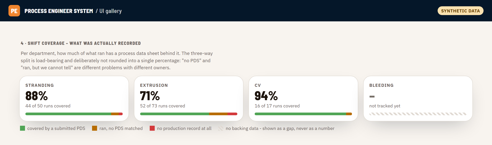
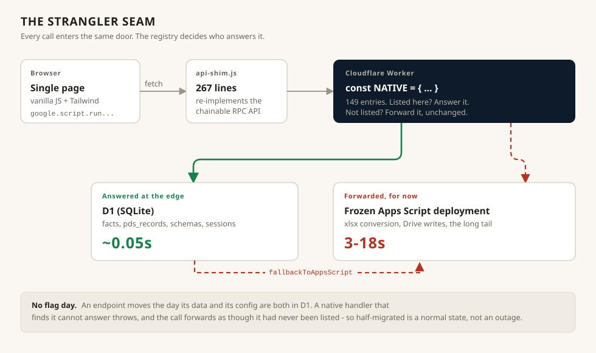

# Process Engineer System

A production web application for the process engineering department of a
cable-manufacturing plant. It replaced the paper and Excel workflow four teams
used to record what actually happened on the production lines: process data
sheets, daily shift reports, quality logs, trials, maintenance, workshop
requests and target times.

It is in daily use by the plant's engineers.

<!-- TODO(you): if you want a date here, add the real one - e.g. "in daily use
     since March 2026". I left it out rather than guess. -->

**This repository is a curated, sanitised showcase.** It is not the
deployment. See [What is and is not here](#what-is-and-is-not-here).

---

## The problem

A cable is built in layers. A copper rod is drawn down to wire, the wires are
stranded into a conductor, the conductor is insulated, screened, armoured and
sheathed - each on a different line, by a different team, on a different
shift. Every one of those steps has a process data sheet: the settings the
engineer dialled in, and the measurements that came back.

Those sheets were paper. That meant:

- a setting that worked last month was findable only if you remembered which
  binder it was in
- nobody could answer "what did we actually run on this order" without walking
  to the line
- a measurement that drifted out of tolerance was visible only to whoever was
  holding the page
- shift handover was verbal

The application answers those four things. Its core is not a form builder - it
is the observation that fourteen visually different documents are one document
with fourteen configurations.

## Architecture

The app began inside Google Apps Script and no longer lives there. It was
moved, endpoint by endpoint, onto a static frontend and an edge gateway, with
the old system still answering whatever had not moved yet.

| Layer | What it is |
|---|---|
| Frontend | Static single page on Cloudflare Pages. Vanilla JS + Tailwind, no build step, no framework. |
| Transport | `api-shim.js` reimplements `google.script.run`'s chainable API over `fetch`, so none of the existing call sites had to change. |
| Gateway | Cloudflare Worker. A registry of 149 endpoints answered natively; anything else forwarded. |
| Data | D1 (SQLite at the edge) for production facts, records, schemas and sessions. Google Drive still holds documents and photos. |
| Legacy | A frozen Apps Script deployment, answering the long tail - chiefly xlsx conversion and Drive writes. |

## Scale

| | |
|---|---|
| Frontend (single page) | ~34,600 lines, ~1,700 functions |
| Gateway (Worker) | ~35,500 lines |
| Target-time engine | ~2,300 lines, shipped here in full |
| Form types, all schema-driven | 14 |
| Endpoints answered at the edge | 149 |
| D1 migrations | 58, append-only |
| Latency, before and after | 3-18s forwarded, ~0.05s native |

## Four pieces worth reading

**[Moving a live app off Apps Script](docs/migration.md)** - a strangler-fig
migration with four departments using the thing every shift. Why the platform
was the bottleneck and not the database, how a half-migrated endpoint is made
into a normal state rather than an outage, and the four things that actually
cost time.
Code: [`src/gateway/native-map.excerpt.js`](src/gateway/native-map.excerpt.js),
[`src/frontend/api-shim.js`](src/frontend/api-shim.js),
[`src/gateway/wrangler.sanitised.toml`](src/gateway/wrangler.sanitised.toml).

**[The forms engine](docs/forms-engine.md)** - fourteen process data sheets,
one renderer. A department is a schema entry, not a code path. The spine of
the application, and the decision I would defend hardest.
Code: [`src/engine/schemas.excerpt.js`](src/engine/schemas.excerpt.js),
[`src/frontend/pds-renderer.excerpt.js`](src/frontend/pds-renderer.excerpt.js),
[`src/engine/Forms.js`](src/engine/Forms.js).

**[A test that passed while everything was broken](docs/parity-harness.md)** -
the target formulas exist in two runtimes and must not drift. The harness that
proves they haven't, and the two runs where it reported "identical" because
both engines were returning `null` for everything.
Code: [`src/tools/parity_sc.js`](src/tools/parity_sc.js).

**[The target-time engine](docs/target-times.md)** - "how long should one
kilometre take on this line?", answered from drum geometry, die schedules and
line speeds rather than from a guess. Declarative models, every constant
traceable, and a drum-capacity formula that is wrong by 27% if you do the
obvious thing.
Code: [`src/engine/Targets.js`](src/engine/Targets.js).

There is also **[four ways the platform corrupted correct
code](docs/apps-script-hazards.md)**, which is now history - Pages serves the
file byte for byte - but is the clearest thing here about how I debug.

## Screenshots

Every screen of the real application is full of live work orders, machine
codes, TDS numbers and the names of the engineers who filed each record, so
none of these are production captures.

They are rendered from [`assets/ui-gallery.html`](assets/ui-gallery.html),
which loads the production stylesheet byte for byte - all 106KB of it,
including the OKLCH token system - and feeds the real component markup
synthetic data. Real styling, real layout, invented numbers. Open it yourself
and check.

| | |
|---|---|
| [Stranding cage grid](assets/shot-cage-grid.png) | the hardest layout in the app |
| [Zone matrix + variance](assets/shot-zone-variance.png) | set against actual, with tolerance |
| [Target time trace](assets/shot-target-trace.png) | every number, and where it came from |
| [Shift coverage](assets/shot-coverage.png) | what was recorded, and what wasn't |

## What is and is not here

**Here:** four engine modules in full (`Targets.js`, `Forms.js`, `TdsLog.js`,
`Parity.js`), the transport shim in full, the parity harness, a sanitised
Worker config, representative excerpts from the two very large files, and the
write-ups above.

**Not here:** the deployment. Specifically removed -

- all Drive, Sheets, Apps Script, Worker and D1 identifiers, replaced with
  `REPLACE_WITH_...` placeholders
- the plant's real line inventory, equipment vendors, works order numbers and
  machine serial numbers - replaced with a **fictional but structurally
  identical** set, so the code reads the way it really does
- production rates, drawing speeds, stranding RPM, equipment capability
  figures and reference workbooks
- employer branding and logo
- the commit history, which contains all of the above

Every number, machine code and supplier name in this repository is invented.
None of it describes a real facility.

**Also not here:** the two largest files in their entirety - the frontend at
~34,600 lines and the Worker at ~35,500. They are excerpted rather than
dumped, because a wall of code is not a portfolio.

`src/engine/Parity.js` is unrelated to the parity harness, despite the name.
It is the Apps Script module that kept the rebuilt client at parity with
server functions the old system had.

## A note on judgement

Two things here are deliberately *less* clever than they could be, and both
are load-bearing.

**The app shows a gap rather than a number** wherever it does not genuinely
have the data. A dashboard that invents a plausible figure is worse than one
that admits the gap, because an engineer will act on it. This is enforced, not
aspirational: a calculation with a missing constant returns `null` and names
what is missing, and the total then reports as unavailable rather than as a
confident wrong answer. The "not tracked yet" card in the coverage screenshot
above is that rule, visible.

**The global error banner** at the top of the client script looks like debug
clutter left in by accident. It is the only thing that turns a silent
client-side failure into a visible message instead of a page that never
finishes loading. Removing it means debugging blind.

## Licence

All rights reserved - see [LICENSE](LICENSE).

This repository is published for portfolio review only. The code is a
sanitised extract of a private production system developed as work product; no
reuse rights are granted. Read it, ask me about it - but it is not yours to
fork.
