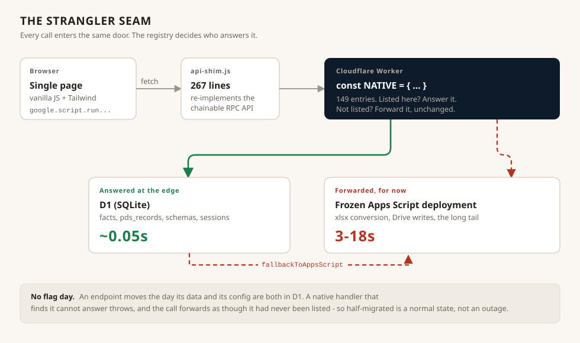

# Moving a live app off Apps Script without a flag day



The application was built entirely inside Google Apps Script. Spreadsheet as
database, `HtmlService` as web server, `google.script.run` as RPC. For getting
something real in front of engineers in a plant with no infrastructure budget
and no admin rights on the workstation, that was the right call and I would
make it again.

It was the wrong thing to keep.

## The number

```
forwarding costs 3-18s, answering here ~0.05s
```

That comment sits above the registry in the Worker and it is the entire
argument. Two to three orders of magnitude, on calls an engineer makes dozens
of times a shift while standing at a machine with gloves on.

The important part is *why*, because the obvious diagnosis is wrong. It is not
the database. Spreadsheet reads are slow, but tuning them barely moved the
needle. The cost is Apps Script's execution model: every `google.script.run`
call is an iframe-mediated round trip into a runtime that spins down when idle
and pays a cold start on the next hit - measured at 9.2 seconds cold against
well under a second warm. No amount of query optimisation touches a fixed tax
on the transport.

The evidence that settled it was a colleague's static app on the same plant
network, doing comparable work, feeling instant. Same network, same browsers,
same users. The platform was the variable.

## Why not a rewrite

Four departments were using it every shift. A rewrite means a date on which
everything changes at once, and a rollback plan that nobody believes. The
honest estimate for a from-scratch replacement was months during which the old
thing still had to be maintained.

So: a [strangler fig](https://martinfowler.com/bliki/StranglerFigApplication.html).
Put the new system in front of the old one, move one endpoint at a time, and
let the old one shrink until there is nothing left in it.

## How it actually works

**A Cloudflare Worker sits in front of everything.** Every call from the
browser hits `/api` on the Worker. The Worker looks the function up in a
registry:

```js
const NATIVE = {
  getProductivityRuns: { auth: 'user', scope: {...}, handler: nativeGetProductivityRuns },
  getPdsSchema:        { auth: 'user', scope: { tab: 0 }, handler: nativeGetPdsSchema },
  login:               { auth: 'public', handler: nativeLogin },
  // ...149 of them
};
```

Listed: answered from D1, at the edge. Not listed: forwarded to a frozen Apps
Script deployment exactly as before. Migration is adding an entry.

**The frontend did not change.** `api-shim.js` reimplements the surface
`index.html` already used:

```js
google.script.run
  .withSuccessHandler(fn)
  .withFailureHandler(fn)
  .someBackendFunction(a, b)
```

and routes it over `fetch` to the Worker instead. Its own header explains the
reasoning better than I can paraphrase: there were 54 call sites, and
rewriting each into a promise call is 54 chances to change behaviour subtly,
especially around failure handlers, which are easy to drop. Keeping the API
means the call sites stay byte-identical and the risky translation happens
once, in 267 reviewable lines.

**A half-migrated endpoint is a normal state.** This is the detail I am most
pleased with. A native handler that discovers it cannot answer - a department
whose data has not been migrated, a user the edge has not been told about -
throws an error carrying a flag:

```js
e.fallbackToAppsScript = true;
```

and the request forwards as though it had never been listed. `login` uses it
so that a user-sync running behind cannot lock anybody out of the plant's
system at 6am. Without that, every migration step would be all-or-nothing per
endpoint, and each one would need its own rollback.

## What it cost

Things that were genuinely hard, none of which are in the architecture
diagram:

- **Config has to move before code can.** "Adding one means its data AND its
  config must already be in D1 - that is the real work, not the routing." A
  schema left behind in a spreadsheet silently reverts a code change, because
  the Worker reads the stale copy. That bit more than once and is now written
  down as a standing warning about seeds that are not one-time.
- **Booleans.** D1 is SQLite; there is no boolean type. A `true` that round
  trips as `1` is fine until something does a strict comparison.
- **Merge, never replace.** An early upsert wrote `''` into every column the
  payload omitted, which is the actual cause of a long-running "data missing
  from daily reports" complaint. The D1 side uses `json_patch` now. This is a
  class of bug worth naming: a write path that is lossy only for *partial*
  payloads looks correct in every test that sends a complete one.
- **The read budget.** Exhausting D1's write quota silently disables the
  aggregate cache, at which point reads explode and the whole app slows down
  for a reason that has nothing to do with the slow page. The gateway now
  emits an `X-Query-Log` header so a slow screen can be traced to its queries.

## Where it stands

The frontend is static on Cloudflare Pages. The gateway is a Worker with D1
holding production facts, PDS records, form and spec schemas, sessions, TDS
rows and the machine directory. 149 endpoints answer natively. The remainder -
chiefly xlsx conversion and Drive writes, which want a runtime with Google
credentials - still forward to a frozen Apps Script deployment, and that is a
deliberate stopping point rather than an unfinished one.

The original Apps Script project is no longer the product. Its `Targets.js` is
still the source text the Worker's copy of the formulas is lifted from, which
is its own problem - see [the parity harness](parity-harness.md).

## The trap that keeps coming back

`public/index.html` on Pages is a **fork** of the Apps Script `index.html`, not
a build output. There is a `build.js` that would regenerate it, and running it
deletes well over a thousand lines that exist only in the fork.

The repo's README asserted the opposite - that the file was not forked - and
that single stale sentence survived three separate re-drifts and cost a near
miss. It is now contradicted explicitly in the contributor notes, in capitals.

The lesson generalises past this codebase: a stale sentence in a README is
worse than no sentence, because it is load-bearing in exactly the moment
somebody is moving fast and looking for permission.
