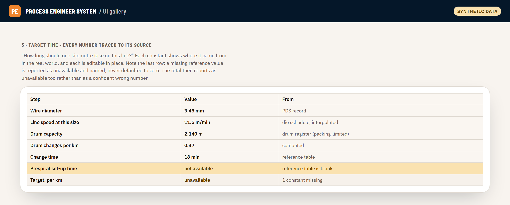
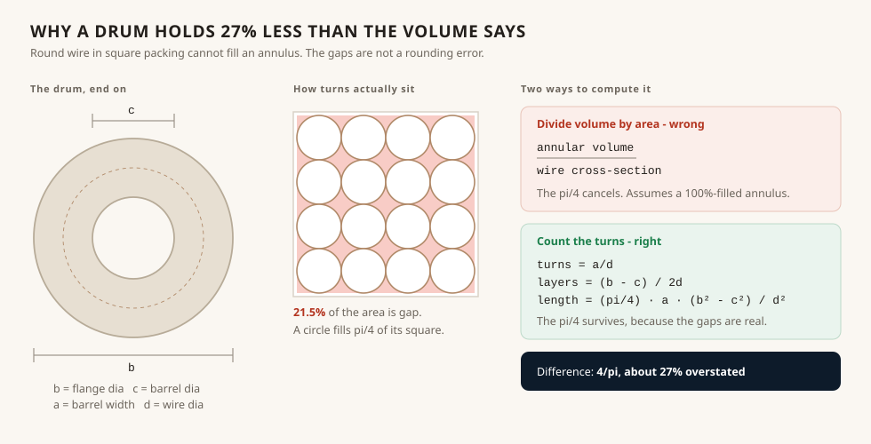

# The target-time engine

"How long should one kilometre take on this line?"

Every plant needs that number. It sets the schedule, it sets what counts as a
bad shift, and it is usually somebody's memory. The engine computes it from
drum geometry, die schedules and line speeds, and shows its working.

Code: [`src/engine/Targets.js`](../src/engine/Targets.js) (2,342 lines, shipped
in full).



*Every constant shows where it came from, and a missing one is named rather
than defaulted. Synthetic data.*

## Two modes, one model

**Manual** is a calculator. Every number is typeable - not just the per-order
variables, but every constant too, each pre-filled from its reference table and
editable in place. An engineer who knows this particular drum is not standard
can say so.

**Work order** resolves the per-order variables from the master plan and the
department's own process data sheets, each value carrying where it came from,
and all of them still editable.

Both run the same model, because a model is data:

```
context   - the selectors that pick which reference rows apply
inputs    - the per-order variables
constants - every value read from a reference table, declared once with
            where it lives, so it can be listed, traced and overridden
            without any step function knowing about overrides
steps     - the ordered chain, each an ordinary named function
```

One generic server entry point runs any model; one generic client renderer
draws any model. Adding a department is a registry entry. This is the same
discipline as [the forms engine](forms-engine.md), applied to calculation.

## Provenance is a first-class field

Every declaration carries an `origin` - reference table, master plan, PDS
record, shared construction table, or the engineer's own judgement. That is not
decoration. It is what lets the system print its own data inventory:

> `describeTargetData()` is able to print the whole data inventory from the code
> rather than from a document that drifts out of date.

When you are asking a plant to fill in sixty-odd reference constants before a
feature works, being able to generate the list of exactly what you need, from
the code that will consume it, is the difference between a request that gets
answered and one that does not.

## Missing inputs do not get defaults

```
A blank constant yields null for that step plus the constant's name in
`missing` - never silently defaulted, and the total reports as unavailable
rather than as a plausible wrong number.
```

This is the rule the whole repository is built on and it matters most here. A
target time is a number a supervisor will hold a shift to. A default that
quietly stands in for a missing die schedule produces a target that is wrong in
a way nobody can see. Reporting "unavailable, because these three constants are
blank" is less satisfying and much more useful.

The same instinct drives `targetInterpolate_`, which returns `null` outside the
tabulated span rather than extrapolating - because a drawing line's speed falls
away steeply with wire size, and a straight line pushed past the end of the
table produces a confident wrong answer and eventually a negative one.

## The best bug in the codebase

How much wire fits on a drum? The obvious method: take the annular volume
between the barrel and the flange, divide by the cross-sectional area of the
wire.

That is wrong by 27%.



The comment explaining it is my favourite thing in this project:

```js
/*  turns across the barrel width  = a / d
 *  radial layers                  = (b - c) / (2d)
 *  mean circumference             = pi (b + c) / 2
 *  length = (a/d) x (b-c)/(2d) x pi(b+c)/2 = (pi/4) x a x (b^2 - c^2) / d^2
 *
 *  NOTE the pi/4, which is the whole point. Dividing the annular VOLUME by the
 *  wound cross-sectional AREA cancels it and so assumes a 100%-filled annulus,
 *  which round wire can never reach - square packing leaves about 21.5% of the
 *  annulus as gaps between turns. That route over-states capacity by 4/pi,
 *  about 27%. */
```

Counting loops instead of dividing volumes keeps the `pi/4`, because round wire
laid in square packing cannot fill an annulus. A 27% over-statement of drum
capacity is a drum that is declared good for a full order and runs out
three-quarters of the way through.

Capacity is then the *smaller* of what physically packs on and what the drum's
weight rating allows - and either constraint may be unknown, in which case the
answer rests on whichever is known, and is null only if neither is.

## What is not here

The reference workbooks - die schedules, stranding RPM tables, extruder
profiles, drum registers - are the plant's data and are not in this repository.
The engine reads them from a seed workbook the plant fills in. What is here is
all of the logic that consumes them.
